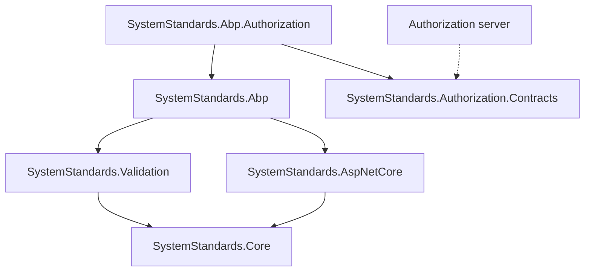
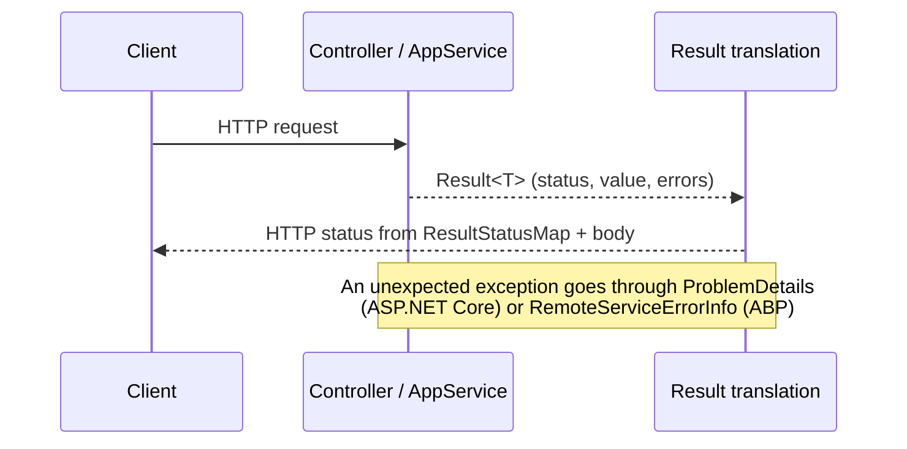
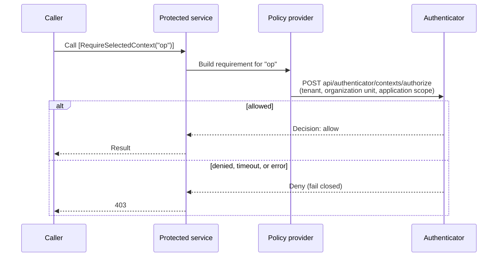

# SystemStandards

[](https://www.nuget.org/packages/SystemStandards.Core)


Result-pattern building blocks for ASP.NET Core and ABP Framework projects, released as one
lockstep package family. Every package in the family shares a single version.

Instead of throwing for expected outcomes, a service returns a `Result<T>` that carries a status,
a value, and errors. The web layer turns that status into the right HTTP response, and the ABP layer
makes ABP's own exceptions speak the same language. The Byd modular platform uses this family as
its response envelope.

## Contents

- [Packages](#packages)
- [How the pieces fit](#how-the-pieces-fit)
- [Result statuses](#result-statuses)
- [Features](#features)
- [Configuration](#configuration)
- [Install](#install)
- [Usage](#usage)
- [Versioning](#versioning)
- [Development](#development)
- [License](#license)

## Packages

| Package | Depends on | What it gives you |
|---|---|---|
| `SystemStandards.Core` | — | `IResult`, `Result<T>`, `ResultStatus`, `ResultStatusMap` |
| `SystemStandards.Validation` | Core | FluentValidation integration and localized validation messages |
| `SystemStandards.AspNetCore` | Core | ProblemDetails middleware, `TranslateResultToActionResult`, `OperationContext` |
| `SystemStandards.Abp` | AspNetCore, Validation | ABP module, exception-to-`RemoteServiceErrorInfo` mapping, `ICurrentUser` enrichment, opt-in `[AbpResultWrap]` |
| `SystemStandards.Authorization.Contracts` | — | Authenticator wire contract: claim names, headers, decision payload, failure codes. Deliberately dependency-free |
| `SystemStandards.Abp.Authorization` | Abp, Authorization.Contracts | Fail-closed tenant / organization-unit / application-scope authorization client over the Authenticator decision endpoint |

`Authorization.Contracts` carries no dependencies on purpose: it is the single truth shared by
the client wrapper and the authorization server, so neither side's framework choice leaks into
the other.

## How the pieces fit





## Result statuses

| `ResultStatus` | Value | Default HTTP status | Typical use |
|---|---|---|---|
| `Ok` | 0 | 200 OK | Read or update succeeded |
| `Created` | 1 | 201 Created | A new resource was created |
| `NoContent` | 2 | 204 No Content | Success with nothing to return, e.g. delete |
| `Error` | 3 | 500 Internal Server Error | A handled failure |
| `Invalid` | 4 | 400 Bad Request | Validation errors |
| `NotFound` | 5 | 404 Not Found | The resource does not exist |
| `Forbidden` | 6 | 403 Forbidden | Authenticated but not allowed |
| `Unauthorized` | 7 | 401 Unauthorized | Not authenticated |
| `Conflict` | 8 | 409 Conflict | Duplicate or concurrent change |
| `CriticalError` | 9 | 500 Internal Server Error | A failure that needs attention |
| `Unavailable` | 10 | 503 Service Unavailable | A dependency is down |

The mapping lives in `ResultStatusMap` and can be changed per application, for example
`.For(ResultStatus.Conflict, HttpStatusCode.Conflict)`.

## Features

### Result pattern (`SystemStandards.Core`)

`Result<T>` carries the status, the value, and a list of errors; `IResult` is the non-generic view
used by the translation layer. Services return outcomes instead of throwing for expected cases.

### Validation (`SystemStandards.Validation`)

FluentValidation failures become an `Invalid` result with localized messages, so validation and
business outcomes share one envelope.

### ASP.NET Core translation (`SystemStandards.AspNetCore`)

| Building block | What it does |
|---|---|
| `TranslateResultToActionResult` | Turns a returned `Result<T>` into the matching `ActionResult` |
| ProblemDetails middleware | Writes unexpected exceptions as RFC 7807 problem details |
| `OperationContext` | Carries the request's correlation and caller information through the pipeline |

### ABP integration (`SystemStandards.Abp`)

`SystemStandardsAbpModule` wraps ABP's `DefaultExceptionToErrorInfoConverter` and fills the
`Code` field with a `ResultStatus` value only when ABP leaves it empty. ABP's own exception
boundary and validation details stay intact. `[AbpResultWrap]` is an opt-in action filter that
wraps an action's return value in the result envelope.

### Selected-context authorization (`SystemStandards.Abp.Authorization`)

A protected action or application service method is bound to an operation name with
`[RequireSelectedContext(MyPermissions.Sources.Manage)]`. On each call the client asks the
Authenticator's decision endpoint whether the caller may perform that operation in the selected
tenant, organization unit, and application scope. The client fails closed: an unreachable server,
a timeout, or an unreadable answer denies the request.



The wire contract in `Authorization.Contracts`:

| Kind | Names |
|---|---|
| Claims | `sub`, `client_id`, `scope`, `actor_kind`, `tenant_id`, `organization_unit_id`, `application_scope_id` |
| Headers | `X-Authenticator-Correlation-Id`, `X-Authenticator-Privileged-Reason` |
| Endpoint | `api/authenticator/contexts/authorize` |

## Configuration

The authorization client reads `SystemStandards:Authenticator` through `IOptions<T>`. Missing or
invalid values stop the application at startup (fail-fast); no address, path, or duration is
hard-coded.

| Key | Default | Meaning |
|---|---|---|
| `BaseUrl` | — (required) | Absolute http/https root of the authorization server |
| `AuthorizePath` | `api/authenticator/contexts/authorize` | Decision endpoint, relative to `BaseUrl` |
| `Timeout` | `00:00:10` | Upper bound for one remote attempt |
| `RequiredScope` | — | Scope expected in the token; empty skips the client-side scope check |
| `RetryAttempts` | `2` | Retries on transient failures |
| `RetryDelay` | `00:00:00.5` | Base delay between retries |

```json
{
  "SystemStandards": {
    "Authenticator": {
      "BaseUrl": "https://auth.example.com",
      "RequiredScope": "my-api"
    }
  }
}
```

## Install

Most consumers take the layer they need; the rest arrives transitively.

```
dotnet add package SystemStandards.Abp
dotnet add package SystemStandards.Abp.Authorization
```

## Usage

Add the module to your ABP host and register the authorization client:

```csharp
[DependsOn(typeof(SystemStandardsAbpModule))]
public class MyHostModule : AbpModule
{
    public override void ConfigureServices(ServiceConfigurationContext context)
    {
        context.Services.AddAuthenticatorAuthorization();
    }
}
```

Protect an operation:

```csharp
[RequireSelectedContext(MyPermissions.Sources.Manage)]
public virtual Task<SourceDto> UpdateAsync(Guid id, UpdateSourceDto input) { ... }
```

## Versioning

The family is versioned in lockstep: a release publishes every package at the same version,
even when only one of them changed. This keeps the internal dependency graph consistent and
avoids the drift that piecemeal releases produce. The current version is `2.1.0`.

Published versions are immutable. A change always means a new version.

## Development

```
dotnet build SystemStandards.slnx
dotnet test SystemStandards.slnx
```

Each package has a matching test project under `test/`. The release manifest is
`nuget-release.json`.

## License

MIT
